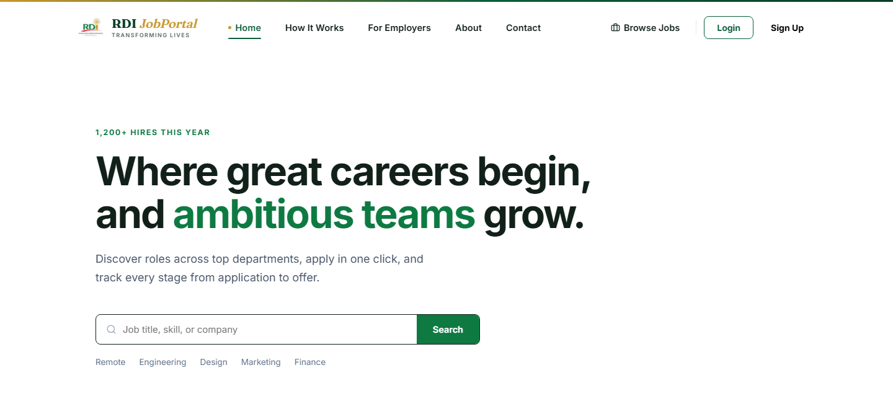
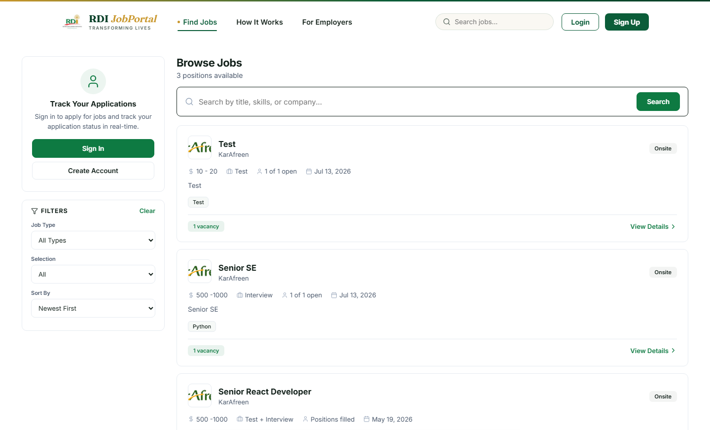
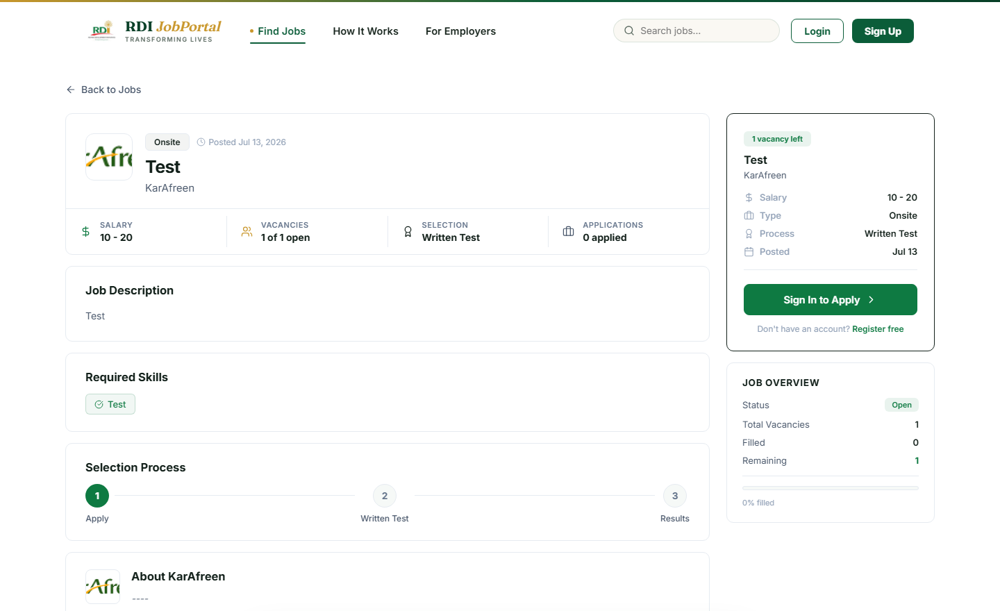
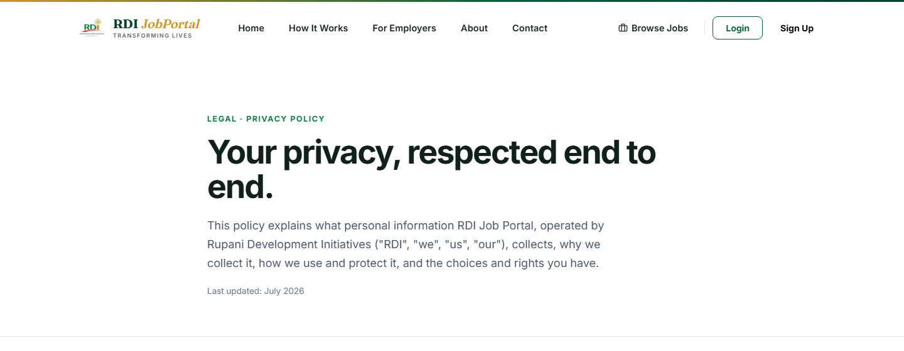

<div align="center">


<br/>

**A full-stack recruitment platform by Rupani Development Initiatives — connecting ambitious talent with employers building brighter futures.**

<br/>


</div>

---

## 📖 What is this?

**RDI Job Portal** is a global hiring platform with three distinct roles baked in:

| Role | What they do |
| --- | --- |
| 🧑‍💼 **Job Seekers** | Build one profile, browse and search openings, apply in a click, save jobs, take role-specific assessments inline, and track every application from *applied → test → interview → offer* in real time. |
| 🏢 **Departments / Employers** | Post roles with structured salary, employment type & location, review applicants, run tests + interviews, and manage their own hiring pipeline. |
| 🛡️ **Super Admin** | Oversee the whole platform — departments, jobs, employees, activity logs, and an analytics dashboard with live charts. |

It ships with a React single-page front end, a Django REST API backend, JWT authentication, email job alerts, GDPR-style cookie consent, full legal pages, and a search-engine / AI-crawler optimization layer (sitemap, robots, per-job structured data, and a server-rendered crawler route).

<div align="center">
<br/>

<br/><br/>
</div>

---

## ✨ Features

**For everyone**
- 🔎 Fast job search & filtering (type, selection process, sort)
- 📄 SEO-friendly slug URLs (`/jobs/senior-react-developer`)
- 🍪 Cookie-consent banner + full **Privacy Policy**, **Terms & Conditions**, and **Cookie Policy** pages
- 🚫 Custom 404 page, loading skeletons, and a React error boundary (no blank/white screens)

**For job seekers**
- 👤 One profile, unlimited applications with live status tracking
- 🔖 Save / bookmark jobs for later
- 🔔 Email **job alerts** by keyword & job type
- 📝 Inline skills assessments and résumé management

**For admins & employers**
- 📊 Super-admin **analytics dashboard** with dependency-free inline-SVG charts (applications by status, jobs per department, applications over time)
- 🗂️ Applicant tracking across every hiring stage
- 💰 Structured per-job **salary, employment type & location** fields

**Discoverability (SEO / GEO)**
- 🗺️ Dynamic `sitemap.xml` with per-job slug URLs
- 🤖 `robots.txt` that explicitly welcomes AI / generative-search crawlers
- 🧠 Per-job **JobPosting** structured data (`baseSalary`, `employmentType`, `jobLocation`) + Open Graph / Twitter cards
- 🖥️ Server-rendered **crawler route** so JS-blind bots & social scrapers see real per-job content

<div align="center">
<br/>
<table>
  <tr>
    <td width="50%"></td>
    <td width="50%"></td>
  </tr>
  <tr>
    <td align="center"><em>Browse & filter jobs</em></td>
    <td align="center"><em>Job detail with selection process</em></td>
  </tr>
</table>
<br/>

<br/>
<em>Minimalist, theme-matched legal pages</em>
<br/><br/>
</div>

---

## 🧰 Tech Stack

| Layer | Technology |
| --- | --- |
| **Frontend** | React 18 (CRA), React Router 6, Axios, lucide-react, inline-style design system |
| **Backend** | Django 5.2, Django REST Framework, SimpleJWT, django-cors-headers, Pillow, ReportLab, openpyxl |
| **Database** | SQLite (default; swap `DATABASES` for PostgreSQL in production) |
| **Auth** | JWT access/refresh tokens with rotation & blacklisting |
| **Email** | Console backend in dev, SMTP via env vars in production |

---

## 📁 Project Structure

```
rdi-job-portal-main/
├── backend/                     # Django REST API
│   ├── accounts/                # Users, auth, notifications, job alerts
│   ├── applicants/              # Applications, saved jobs
│   ├── departments/             # Employer / department entities
│   ├── jobs/                    # Job model, serializers, slug + structured fields
│   ├── tests/ · employees/      # Assessments & employee records
│   ├── job_portal/              # Settings, urls, sitemaps.py, crawler.py
│   └── manage.py
├── job-portal/frontend/         # React single-page app
│   └── src/
│       ├── pages/               # Landing, Jobs, JobDetail, legal pages, SavedJobs…
│       ├── components/          # admin/, brand/, common/, legal/
│       ├── services/            # Axios API clients
│       └── utils/               # jobSchema.js (JobPosting JSON-LD)
└── docs/assets/                 # README banner & screenshots
```

---

## 🚀 Getting Started

### Prerequisites
- **Python 3.10+**
- **Node.js 16+** and npm

### 1 · Backend (Django API → http://localhost:8000)

```bash
cd backend

# create & activate a virtual environment
python -m venv venv
# Windows:
venv\Scripts\activate
# macOS / Linux:
source venv/bin/activate

pip install -r requirements.txt

python manage.py migrate      # runs migrations + seeds the super admin
python manage.py runserver 8000
```

On first migrate, a **super admin** is seeded automatically (override via env vars):

| Field | Default |
| --- | --- |
| Email | `hr@rdi.com` |
| Password | `@RDI123` |

Sign in at the **admin login** page (`/admin/login`) in the front end, or the Django admin at `http://localhost:8000/admin/`.

> ⚠️ Change these credentials before going to production (set `DJANGO_SUPERADMIN_EMAIL` / `DJANGO_SUPERADMIN_PASSWORD`).

### 2 · Frontend (React SPA → http://localhost:3000)

```bash
cd job-portal/frontend
npm install
npm start
```

The app talks to the API at `http://localhost:8000/api` (see `src/services/api.js`).

---

## ⚙️ Production Configuration

Set these environment variables for the backend in production:

```bash
DJANGO_DEBUG=False
DJANGO_SECRET_KEY=<a-strong-random-key>
DJANGO_ALLOWED_HOSTS=hr.rdi.world

# Absolute URLs used in sitemap.xml, robots.txt & the crawler route
SITE_DOMAIN=hr.rdi.world
SITE_PROTOCOL=https

# CORS allow-list (comma-separated)
CORS_ALLOWED_ORIGINS=https://hr.rdi.world

# Email (job alerts) — SMTP
EMAIL_BACKEND=django.core.mail.backends.smtp.EmailBackend
EMAIL_HOST=<smtp-host>
EMAIL_HOST_USER=<smtp-user>
EMAIL_HOST_PASSWORD=<smtp-password>
DEFAULT_FROM_EMAIL="RDI Job Portal <no-reply@rdi.world>"

# Optional super-admin seed overrides
DJANGO_SUPERADMIN_EMAIL=<email>
DJANGO_SUPERADMIN_PASSWORD=<password>
```

> 🔀 **Reverse-proxy note:** `robots.txt`, `sitemap.xml`, and the crawler route `/jobs/<slug>` are served by **Django**. Since `hr.rdi.world/jobs/<slug>` is also the React SPA route, configure your proxy so those paths (or bot user-agents) resolve to the Django backend.

---

## 🔍 SEO / GEO Endpoints

| URL | Purpose |
| --- | --- |
| `/sitemap.xml` | Dynamic sitemap incl. one entry per open job |
| `/robots.txt` | Crawl rules; explicitly allows AI/generative-search bots |
| `/jobs/<slug>` (Django) | Server-rendered per-job HTML with OG tags + JobPosting JSON-LD |

---

## 🛠️ Useful Management Commands

```bash
# Send pending email job-alert digests (schedule via cron / task scheduler)
python manage.py send_job_alerts

# Standard Django
python manage.py makemigrations
python manage.py migrate
python manage.py createsuperuser
```

---

## 🗺️ Roadmap

Planned for a later phase: prerendering enhancements, richer analytics, and additional employer tooling.

---

<div align="center">

**Rupani Development Initiatives** · *Transforming Lives*
<br/>
Offices in the United States · Pakistan · Afghanistan · United Arab Emirates

</div>
